# 엄마 식사 기록 — 함께 자라는 친구

먹은 음식을 이름만 적고 몸무게를 재면, 직접 고른 동물 친구가 함께 자라는 기록 앱(PWA).
빌드 도구 없이 HTML/CSS/JS만으로 되어 있고, 기록은 폰 브라우저(localStorage)에만 저장됩니다.

스크린샷의 몸무게·음식 기록은 화면 확인용 가상의 예시 값입니다(`tests/seed.html`: 처음 52kg, 목표 56kg).

## 성장 단계

| 아기 | 새싹 | 목도리 | 꽃 | 꽃왕관 (목표 도착) |
|---|---|---|---|---|
| 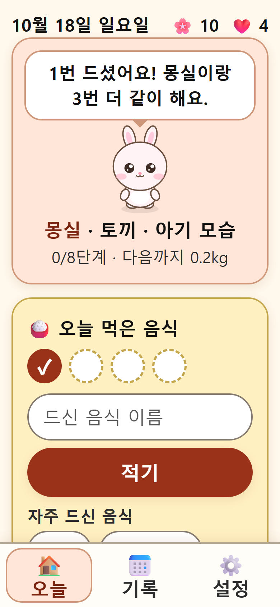 | 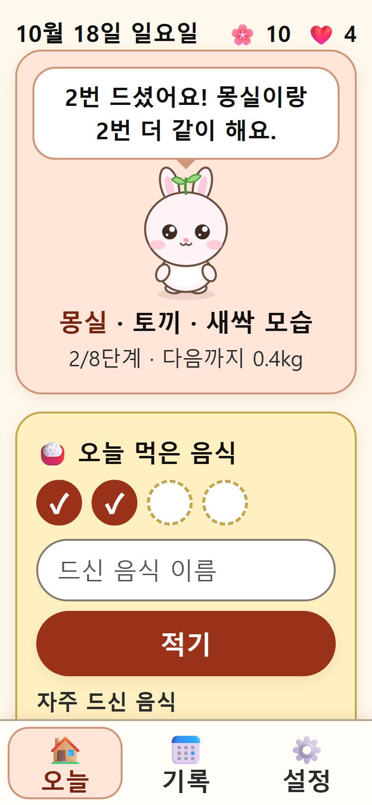 | 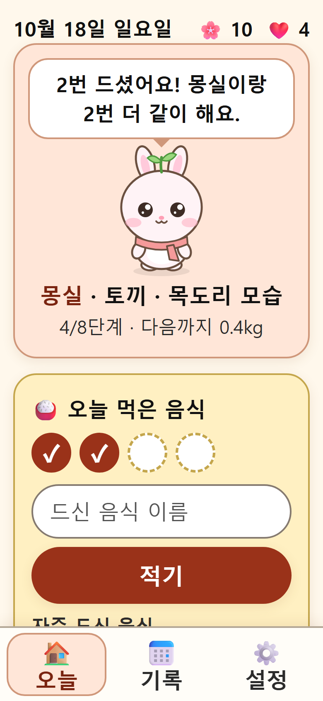 | 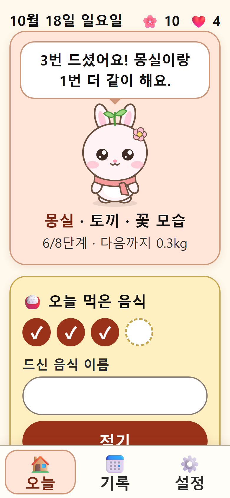 | 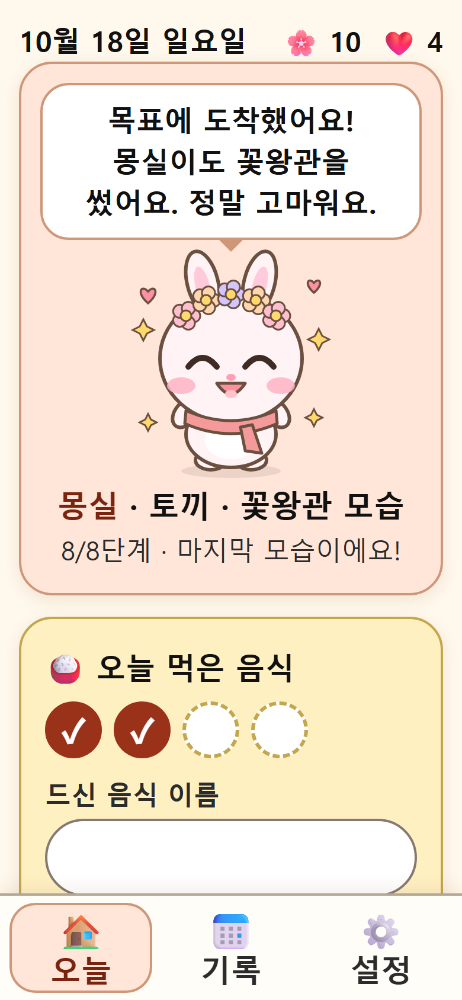 |

### 네 친구 × 다섯 모습

| 기본 | 기뻐할 때 | 응원할 때 |
|---|---|---|
| 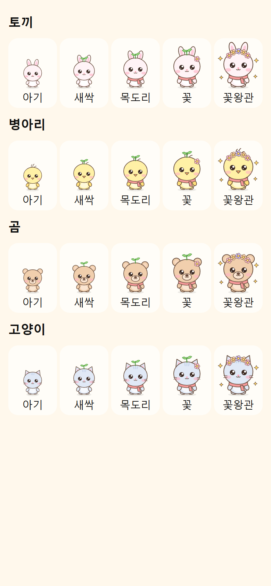 | 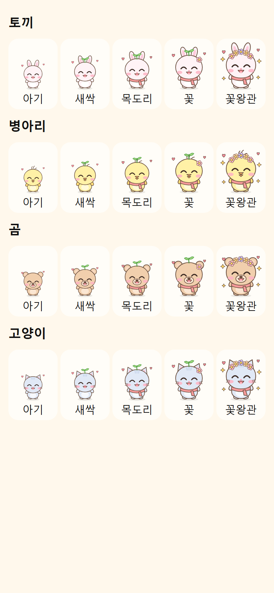 | 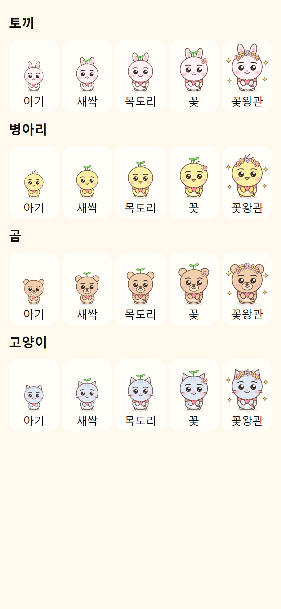 |

다듬기 전과 나란히 비교한 모음은 `docs/screenshots/pets-compare.png`, 다듬기 전 모습은 `pets-before-*.png`입니다.

- 친구들은 이 앱을 위해 단순한 도형으로 직접 그린 SVG입니다(`js/pet.js`). 머리는 크고 몸은 작게, 크고 동그란 눈에 반짝이는 하이라이트 두 개, 연한 분홍 볼터치, 앱과 같은 파스텔 색입니다.
- 표정: 기본은 동그란 눈과 작은 입, **기뻐할 때**(하루 횟수를 다 채운 날·자란 순간)는 웃느라 감은 ^^ 눈·벌린 입·번쩍 든 팔·하트, **응원할 때**(몸무게가 줄어든 날)는 힘준 눈썹과 두 손으로 든 하트.
- 움직임: 가만히 있을 때 살짝 숨 쉬듯 움직이고 가끔 눈을 깜빡입니다(친구마다 깜빡이는 때가 다름). 기쁠 때는 깡충, 응원할 때는 살랑. 기기에서 **"동작 줄이기"를 켜면 모든 움직임이 멈춥니다**. 스크린샷은 움직임을 멈춘 모습으로 찍습니다.

- 처음 몸무게에서 **0.5kg 늘 때마다 한 단계** 자랍니다. 목표까지 필요한 단계 수는 `(목표 − 처음) ÷ 0.5`를 올림한 값입니다(예: 30kg → 38kg이면 16단계).
- 단계가 쌓인 비율에 따라 아기(0~25%) → 새싹(25~50%) → 목도리(50~75%) → 꽃(75% 이상) 모습이 되고, 크기도 단계마다 조금씩 커집니다. **목표 몸무게에 도착해야만** 마지막 꽃왕관 모습이 됩니다.
- 한번 자란 친구는 몸무게가 줄어도 작아지지 않습니다. 줄어든 날은 응원하는 표정과 말만 합니다.
- 성장은 **처음에 고른 측정 시점(예: 아침)의 몸무게로만** 계산합니다. 측정 시점마다 몸무게가 다를 수 있어서, 섞으면 차이만큼 잘못 자라고 다시 작아지지 않기 때문입니다. 다른 시점 몸무게도 기록과 그래프에는 남습니다.
- 잘못 적은 몸무게를 기록 화면에서 지우면, 그 기록으로 올라간 단계도 함께 돌아갑니다(단계는 기록에서 다시 계산합니다).

## 화면

| 처음 시작 | 친구 고르기 | 이름 짓기 | 몸무게·목표 | 다 먹은 날 | 몸무게가 줄어든 날 | 칼륨 주의 |
|---|---|---|---|---|---|---|
| 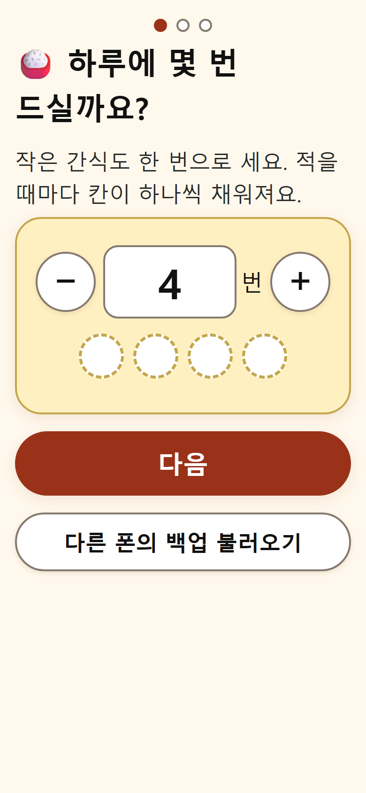 | 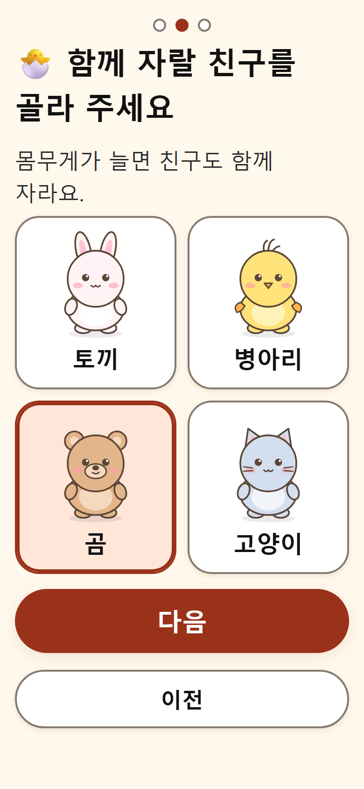 | 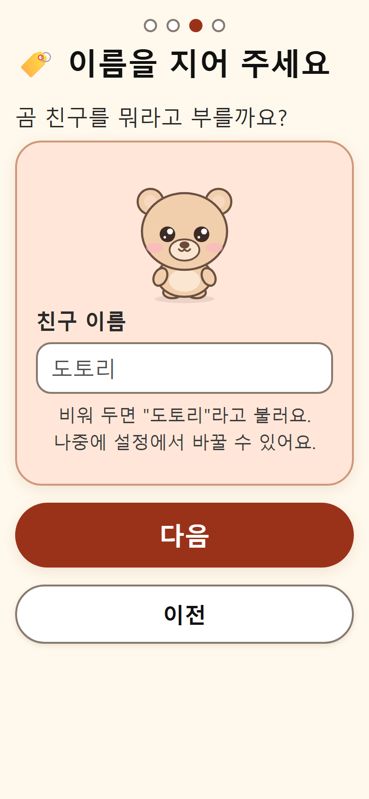 | 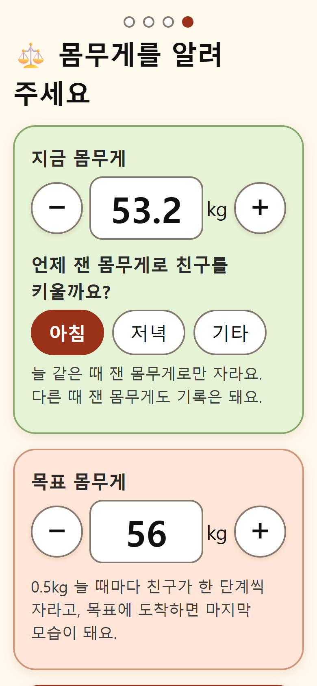 | 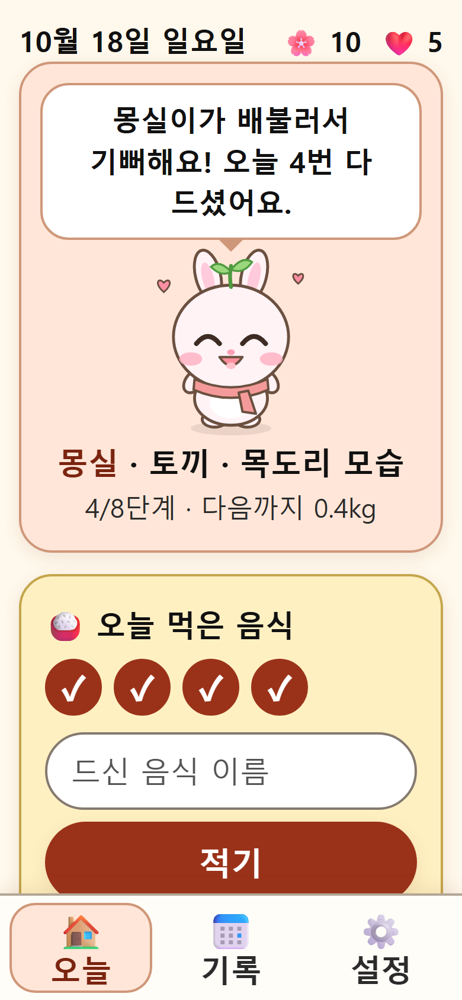 | 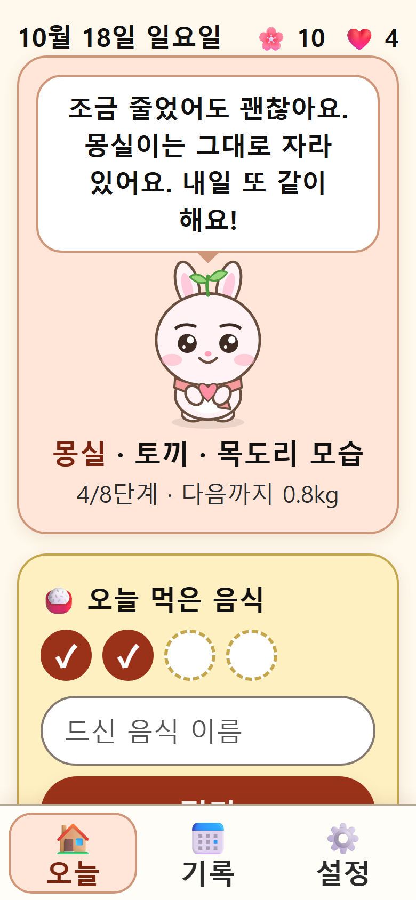 | 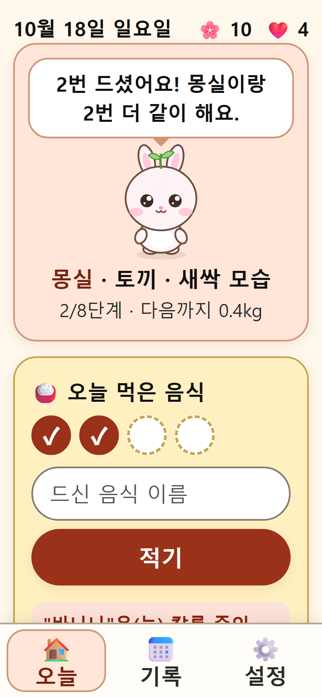 |

- **처음 시작**: 하루 최소 몇 번 먹을지 → 친구 고르기 → 이름 짓기 → 지금 몸무게·측정 시점·목표 몸무게. 예전 화면에서 쓰던 몸무게와 목표가 있으면 미리 채워 줍니다. 다른 폰의 백업도 여기서 바로 불러올 수 있습니다.
- **오늘 (첫 화면)**: 친구, 오늘 먹은 음식(이름만 적기, 칼로리 없음), 오늘 몸무게만 크게 보여 줍니다.
  - 음식을 적을 때마다 오늘 횟수 칸이 하나씩 채워지고, 다 채우면 친구가 기뻐하며 칭찬합니다(`13-celebrate-done.png`).
  - 자주 적은 음식은 버튼으로 다시 누를 수 있습니다(많이 적은 순, 6개).
- **기록**: 몸무게 그래프(예전 몸무게 기록도 그대로 이어짐), 모은 선물, 지난 7일 먹은 음식(예전 화면의 식사 기록 이름 포함), 몸무게 기록 지우기.
- **설정(보호자용)**: 친구 바꾸기(자란 단계는 유지), 친구 이름, 하루 횟수, 목표 몸무게, 측정 시점, 친구를 키우는 몸무게 시점, 칼륨 주의 음식, 백업.
- **보상**: 무엇이든 기록한 날마다 꽃 🌸 한 송이, 하루 횟수를 다 채운 날마다 하트 ❤️ 하나. 기록에서 다시 계산하므로 따로 저장하지 않습니다.

## 친구 이름

- 처음 시작에서 친구를 고른 다음 이름을 지어 줍니다(8글자까지). 비워 두면 동물별 기본 이름(토끼 몽실, 병아리 보리, 곰 도토리, 고양이 나비)으로 부릅니다.
- 첫 화면에 이름이 보이고, 칭찬과 응원 문구에도 이름이 들어갑니다(예: "몽실이가 배불러서 기뻐해요!", "몽실이는 그대로 자라 있어요"). 받침이 있으면 "몽실이가", 없으면 "나비가"처럼 자연스럽게 부르고, 한글이 아닌 이름은 "Coco(이)가"처럼 적습니다.
- 이름은 설정에서 언제든 바꿀 수 있습니다. 이름 기능이 생기기 전에 시작한 사람도 친구·단계·기록은 그대로이고, 기본 이름으로 부르다가 설정에서 이름을 붙이면 됩니다.

## 칼륨 주의 음식

- 설정에 주의 음식 이름을 쉼표로 적어 두면, 그 이름이 들어간 음식을 적었을 때(띄어쓰기·대소문자 무시) 부드럽게 알려 주고 목록에 "칼륨 주의" 표시를 붙입니다. **기록은 막지 않습니다.**
- 설정 화면에 "병원 기준으로 확인하세요" 안내가 있습니다. 앱은 어떤 음식을 권하거나 의학적 조언을 하지 않습니다.

## 저장과 백업

- 기록은 그 폰의 브라우저에만 저장됩니다. 저장 키와 기존 기록(몸무게, 예전 식사 기록, 직접 등록 음식 등)은 그대로 두고 키우기 정보(`grow`)만 더했습니다.
- **전체 백업**에는 키우기 정보(친구, 시작 몸무게, 적은 음식, 주의 음식)도 들어갑니다. 키우기 전에 만든 백업도 불러올 수 있습니다.
- **설정만 내보내기**에는 하루 횟수·친구·칼륨 주의 음식·목표 몸무게·측정 시점이 들어가고, 시작 몸무게와 음식·몸무게 기록은 빠집니다. 불러오면 기록은 그대로 두고, 주의 음식은 없던 것만 더합니다.
- 이 화면은 식약처 음식 영양 데이터(`data/foods.json`)를 쓰지 않아서, 오프라인 저장 목록에서도 뺐습니다. 데이터 파일과 받는 스크립트(`tools/fetch_food_data.py`, `tools/build_food_data.py`)는 `main`의 영양 기록 화면을 위해 그대로 둡니다.

## 실행과 테스트

```sh
python -m http.server 8000      # http://localhost:8000 (서비스 워커는 http://localhost 또는 HTTPS에서만 동작)
python -I tools/run_tests.py    # 계산·화면 동작 테스트, 오프라인 다시 열기, 글씨·대비·버튼 크기 측정 (Edge/Chrome 필요)
python -I tools/screenshots.py docs/screenshots   # 390x844 폰 화면 캡처
```

- `tests/test.html`: 성장 단계(0.5kg·목표 도착·줄어도 유지·측정 시점), 오늘 횟수, 자주 먹은 음식, 보상, 칼륨 주의 단어, 친구 그림, 백업(키우기 정보·예전 백업·설정만 내보내기) 등
- `tests/e2e.html`: 실제 화면에서 처음 시작(예전 기록 이어받기), 음식 적기·다 채우기·지우기, 칼륨 주의, 성장·줄어든 날·다른 시점·목표 도착, 기록 화면과 몸무게 지우기, 백업 내보내기·새 폰에서 불러오기
- `tests/measure.html`: 화면마다 글씨 19px·대비 7:1·버튼 48px 아래로 내려가거나, 칸 안에 안내 글씨(placeholder)가 있으면 실패 (안내는 칸 위의 진한 제목으로 보여 줌)
- `tests/seed.html`, `tests/pets.html`, `tests/frame.html`: 스크린샷용 예시 기록·친구 모음·폰 너비 틀(테스트 전용)

## 배포할 때

- HTTPS 정적 호스팅(GitHub Pages, Netlify 등)에 폴더를 그대로 올리면 됩니다. `tools/`, `tests/`, `docs/`는 올리지 않아도 됩니다.
- 파일을 고친 뒤 다시 배포할 때는 `sw.js`의 `VERSION`을 올려야 폰에 새 버전이 받아집니다.
- 폰에서 주소를 연 뒤 "홈 화면에 추가"하면 앱처럼 설치됩니다.
- 기록은 그 폰의 브라우저에만 있으니, 가끔 설정 → 백업 내보내기를 해 두세요.
