# 엄마 식사 기록

큰 글씨와 적은 버튼으로 식사와 체중을 기록하는 앱(PWA).
빌드 도구 없이 HTML/CSS/JS만으로 되어 있고, 기록은 폰 브라우저(localStorage)에만 저장됩니다.

## 화면

스크린샷의 체중·목표·식사 기록과 "예시"가 붙은 음식의 라벨 수치는 화면 확인용 가상의 예시 값입니다(`tests/seed.html`).

크림색 바탕에 복숭아·연두·하늘·노랑 파스텔 카드, 둥근 버튼과 은은한 그림자로 꾸몄습니다. 즐겨찾기·검색 결과·메뉴에는 음식에 어울리는 이모지(🥚 🍚 🍡 🥛 ⚖️ 등)가 붙고, 음식을 기록하면 "잘 드셨어요!" 같은 축하 문구가 잠깐 뜹니다(`docs/screenshots/15-celebrate.png`). 이모지는 화면 읽기 프로그램이 읽지 않도록 장식으로 표시했습니다.

- 홈은 지금 체중 → 목표까지 남은 양과 진행 막대(같은 측정 시점의 첫 기록부터 목표 하한까지 몇 % 왔는지) → 오늘 드신 양 → 체중 그래프 순서입니다.
- 파스텔 위에서도 글씨는 진하게 유지합니다. 글자 대비는 모두 7:1 이상이고, 폰이 다크 모드여도 어둡게 바뀌지 않습니다(`docs/screenshots/8-home-dark-mode-phone.png`).
- `python -I tools/run_tests.py` 가 화면마다 실제로 보이는 글씨의 크기·대비와 버튼 크기를 재서, 글씨 19px·대비 7:1·버튼 48px 아래로 내려가면 실패합니다(`tests/measure.html`).

| 홈 | 음식 찾기 | 양 고르기 (칼륨 많음) | 칼륨 정보 없음 | 체중 | 설정 |
|---|---|---|---|---|---|
| 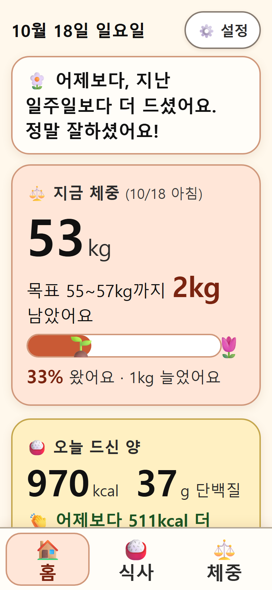 | 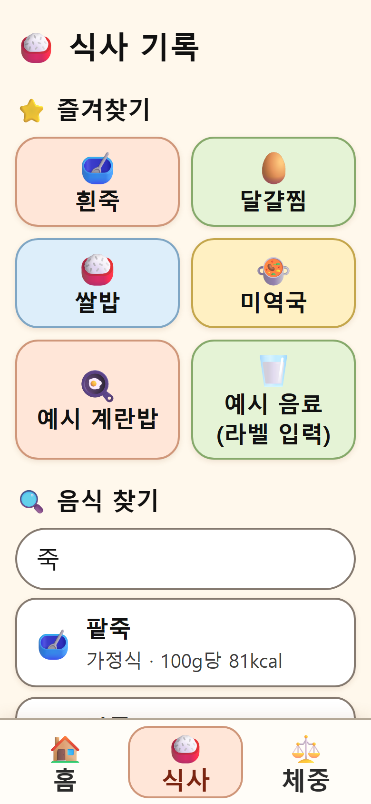 | 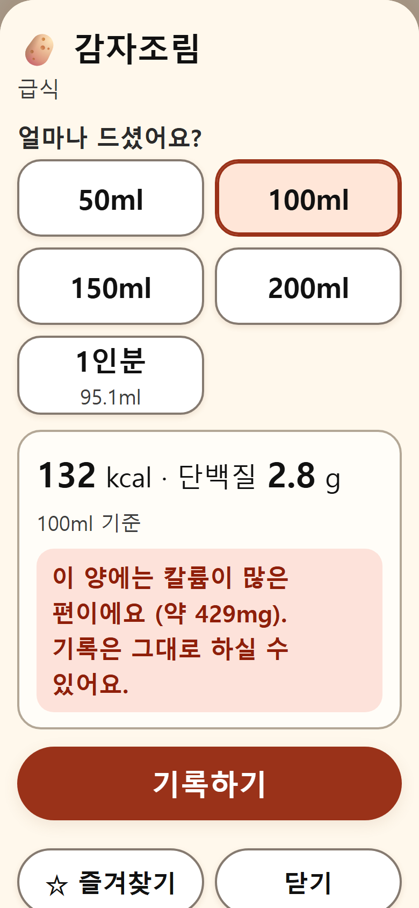 | 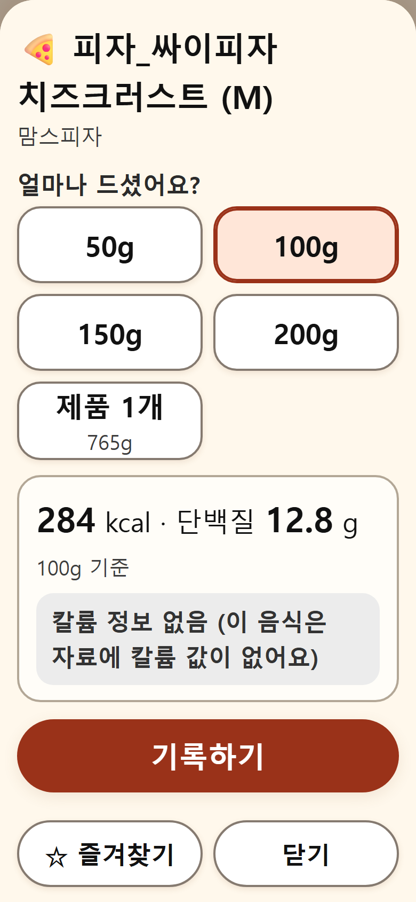 | 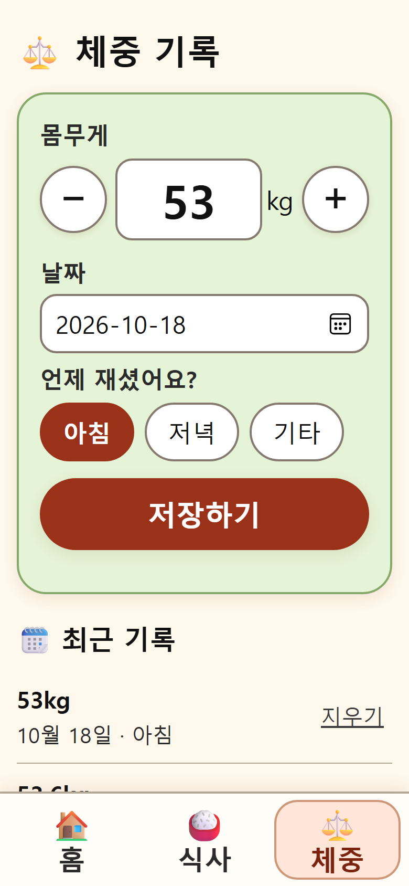 | 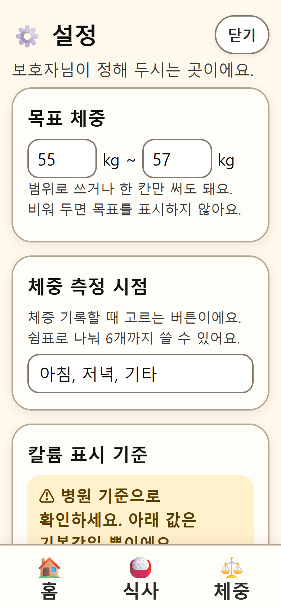 |

- **홈**: 지금 체중, 목표까지 남은 양, 체중 그래프(측정 시점별), 오늘 드신 칼로리·단백질, 어제·최근 7일 평균과 비교한 칭찬
- **식사**: 즐겨찾기 버튼, 음식 이름 검색 → 양 고르기 → 기록. 칼륨이 많으면 부드럽게 알려주고 기록은 막지 않음
- **체중**: 날짜, 측정 시점과 함께 기록. 측정 시점 버튼(기본: 아침/저녁/기타)은 설정에서 바꿀 수 있음
- **설정(보호자용)**: 목표 체중(기본값 없음, 입력 전에는 홈에 입력 안내), 측정 시점, 칼륨 기준값, 음식별 한 그릇(잔) 무게와 개수 단위, 직접 만든 음식, 직접 입력 음식, 백업 내보내기/불러오기, 데이터 출처

### 자주 드시는 음식 편하게 기록하기

| 개수 단위 | 직접 만든 음식 | 재료 고르기 | 라벨 직접 입력 | 수치 입력 전 |
|---|---|---|---|---|
| 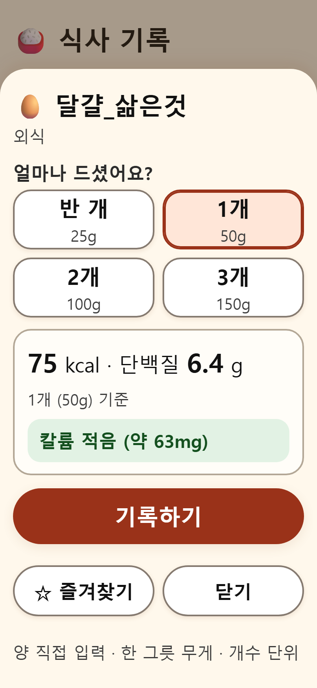 | 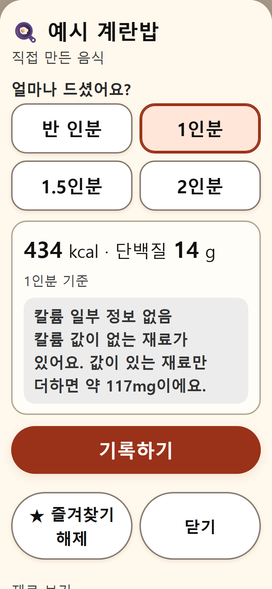 | 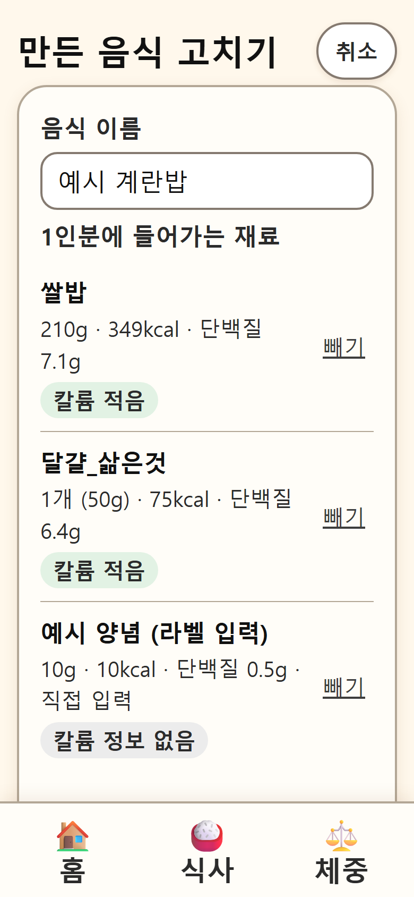 | 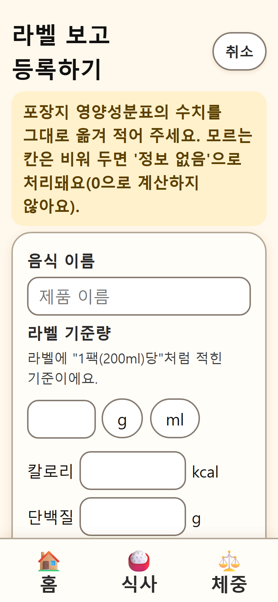 | 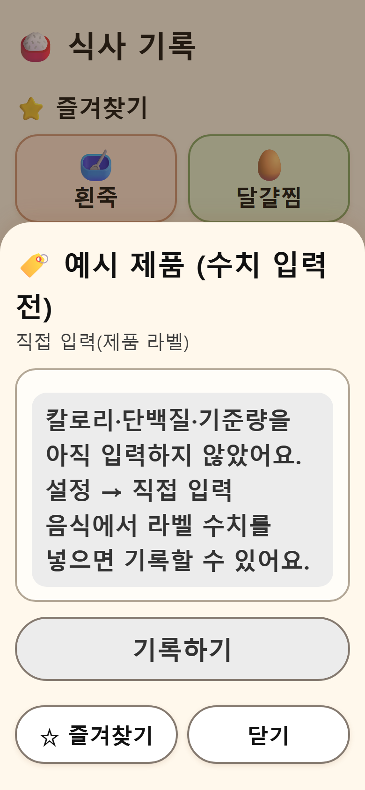 |

- **개수 단위**: 음식마다 "1개 = 50g", "1팩 = 200ml"처럼 정해 두면 기록할 때 "반 개 / 1개 / 2개 / 3개"로 고릅니다. 양 고르기 창 아래나 설정에서 정합니다.
- **직접 만든 음식**: 재료를 골라 양을 정해 1인분을 저장합니다(예: 밥 + 삶은 달걀 1개 + 양념). 영양 수치는 재료 수치를 더한 값이고, 칼륨 값이 없는 재료가 하나라도 있으면 "칼륨 일부 정보 없음"으로 보여 줍니다(값이 있는 재료만 더한 양도 함께 표시).
  - 재료는 식약처 자료와 직접 입력 음식에서 고릅니다. 이 자료는 완성된 요리 위주라 **참기름은 없고 간장도 양념류(초간장 등)만 있습니다.** 이런 재료는 제품 라벨을 보고 직접 입력 음식으로 먼저 등록하세요.
  - 라벨 수치를 고치면 그 재료를 쓴 만든 음식도 다시 계산됩니다. 이미 기록한 식사는 기록할 때 값 그대로 남습니다.
- **직접 입력 음식**: 포장지 영양성분표를 보고 라벨 기준량(예: 200ml)당 칼로리·단백질·칼륨을 넣습니다. 출처는 "직접 입력(제품 라벨)"로 표시됩니다. 모든 수치 칸은 빈칸으로 시작하고, 비운 칸은 0이 아니라 "정보 없음"입니다. 기준량·칼로리·단백질을 채우기 전에는 기록할 수 없습니다.
- 만든 음식과 직접 입력 음식은 저장할 때 바로 즐겨찾기에 추가할 수 있고, 백업에 함께 들어갑니다.

### 백업

- **전체 백업 내보내기**: 기록과 설정 전부. 불러오면 그 폰의 내용이 백업으로 **바뀝니다**.
- **설정만 내보내기**: 즐겨찾기, 직접 만든 음식, 직접 입력 음식, 개수 단위, 한 그릇 무게, 칼륨 기준값, 측정 시점, 목표 체중만 담고 식사·체중 기록은 뺍니다. 불러오면 기존 기록은 그대로 두고 설정만 **합칩니다**.
  - 같은 음식(코드가 같거나, 종류와 이름이 같은 음식)이 이미 있으면 추가하지 않고 기존 음식을 그대로 둡니다. 그 음식을 가리키던 즐겨찾기·개수 단위·재료는 기존 음식으로 연결됩니다.
  - 즐겨찾기는 없던 것만 뒤에 덧붙입니다. 개수 단위·한 그릇 무게는 합치되 같은 음식은 파일의 값으로 바뀝니다.
  - 목표 체중, 칼륨 기준값, 측정 시점은 값이 하나라서 파일의 값으로 바뀝니다.
  - 불러오기 전에 추가할 음식과 건너뛸 음식을 보여 주고 확인을 받습니다. 같은 파일을 여러 번 불러와도 늘어나지 않습니다.

## 음식 영양 데이터

- 출처: 식품의약품안전처 식품영양성분 데이터베이스. 공공데이터포털
  [「전국통합식품영양성분정보(음식)표준데이터」](https://www.data.go.kr/data/15100070/standard.do)
- 데이터 기준일 **2026-09-29**, 내려받은 날 2026-10-17, 19,738개 음식
- 앱에는 이름, 업체명, 분류, 기준 단위, 에너지, 단백질, 칼륨, 식품중량, 출처만 골라서 `data/foods.json`에 넣었습니다. 수치는 원본 그대로이고 추정하거나 채운 값은 없습니다.
- 알아둘 점
  - **칼륨 값이 없는 음식이 15,265개**(대부분 프랜차이즈 업체 제공 자료)입니다. 0으로 계산하지 않고 "칼륨 정보 없음"으로 표시합니다.
  - 5,784개는 **100ml 기준**입니다. 음료뿐 아니라 급식·외식 자료의 일부 반찬(예: 감자조림)도 ml 기준이라, 이런 음식은 양을 ml로 고릅니다. 밀도를 몰라 g으로 바꾸지 않았습니다.
  - 같은 이름이 여러 개인 음식(예: 흰죽)은 가정식/외식/급식 자료라 값이 다릅니다. 검색 결과에 출처 종류와 100g당 kcal을 함께 보여줍니다.
  - "1인분/제품 1개" 버튼은 자료의 식품중량 값이 있을 때만 나옵니다.

### 데이터 새로 받기

```sh
python -I tools/fetch_food_data.py <저장할.json>          # 공공데이터포털 다운로드 버튼과 같은 방식
python -I tools/build_food_data.py <저장한.json> <오늘날짜>  # 형식이 다르면 오류로 멈춤
```

식약처 식품영양성분 DB 사이트(various.foodsafetykorea.go.kr)의 다운로드는 소속·이용목적 등록 양식을 거쳐야 해서 쓰지 않았습니다.

## 칼륨 표시

- 기록하려는 양(한 번에 드시는 양) 기준으로 나눕니다. 기본값은 100mg 미만 적음, 100~200mg 보통, 200mg 이상 많음입니다.
- 기준값은 설정에서 바꿀 수 있고, 설정 화면에 "병원 기준으로 확인하세요" 안내가 있습니다.

## 실행과 테스트

```sh
python -m http.server 8000      # http://localhost:8000 (서비스 워커는 http://localhost 또는 HTTPS에서만 동작)
python -I tools/run_tests.py    # 계산 테스트 + 화면 동작 테스트 + 서버를 끈 뒤 오프라인으로 다시 열기 (Edge/Chrome 필요)
python -I tools/screenshots.py docs/screenshots   # 390x844 폰 화면 캡처
```

- `tests/test.html`: 하루 합계, 그램·기준량 환산, 7일 평균 비교, 칼륨 없음·일부 없음 처리, 칼륨 등급, 개수 단위, 직접 만든 음식 합산, 직접 입력 검사, 백업(새 항목·예전 형식), 설정만 내보내기·합치기·중복 방지, 그래프 라벨 위치, 실제 데이터 값
- `tests/e2e.html`: 실제 앱에서 기록, 칼륨 안내, 한 그릇 무게, 개수 단위, 직접 입력·직접 만든 음식 만들기와 기록, 즐겨찾기, 체중, 검색, 예전 기록 열기, 설정만 내보내기→다른 폰에서 두 번 불러오기
- `tests/seed.html`: 스크린샷용 예시 기록(테스트 전용)

## 배포할 때

- HTTPS 정적 호스팅(GitHub Pages, Netlify 등)에 폴더를 그대로 올리면 됩니다. `tools/`, `tests/`, `docs/`는 올리지 않아도 됩니다.
- 파일을 고친 뒤 다시 배포할 때는 `sw.js`의 `VERSION`을 올려야 폰에 새 버전이 받아집니다.
- 폰에서 주소를 연 뒤 "홈 화면에 추가"하면 앱처럼 설치됩니다.
- 기록은 그 폰의 브라우저에만 있으니, 가끔 설정 → 백업 내보내기를 해 두세요.
